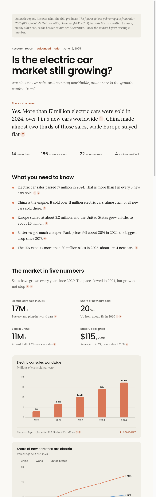

# deepseek-research

**Better web research for any coding agent.** An [Agent Skill](https://agentskills.io) that teaches
Claude Code, Codex, Cursor, Gemini CLI, OpenCode, Hermes and other agents to research the web
properly with DeepSeek's Search & Fetch APIs. Small questions get quick answers with sources.
Big questions get a fact-checked report that looks good enough to send to someone.



## What it does

- **Quick mode** (default): 2-4 targeted searches, reads the best pages, and answers in chat.
  The answer comes first, every fact has a numbered citation, and dates are shown.
- **Advanced mode** ("deep research", "write a report"): a team of agents does the work.
  A planner splits the question, researchers read the sources in parallel, a fact-checker
  checks every quote against the page text, a reviewer looks for gaps and bias, and a writer
  builds the report.
- **A beautiful offline report**: one HTML file with charts, key takeaways, a confidence tag on
  every claim (verified / single source / conflicting), "what we couldn't confirm", and source cards.
  It switches to dark mode automatically and works on a phone. See
  [examples/example-report.html](examples/example-report.html).
- **Cheap**: $0.75 per 1,000 searches. A quick answer costs well under a cent, and a full report
  usually costs 2-5 cents.
- **Nothing to install** apart from Python 3.9+. One script, standard library only.

## Install (one line)

```bash
curl -fsSL https://raw.githubusercontent.com/ry0narushima/deepseek-research/main/install.sh | bash
```

This copies the skill into every agent skills folder it finds: `~/.claude/skills`,
`~/.codex/skills`, `~/.agents/skills`, `~/.cursor/skills`, `~/.gemini/skills`,
`~/.config/opencode/skills`, `~/.hermes/skills`.

Only for the current project (`./.claude/skills`, `./.agents/skills`, and any other agent folders there):

```bash
curl -fsSL https://raw.githubusercontent.com/ry0narushima/deepseek-research/main/install.sh | bash -s -- --project
```

From a clone: `./install.sh` (options: `--project`, `--dir PATH`, `--dry-run`).

## Setup: your DeepSeek key (about 2 minutes)

Run this in your own terminal:

```bash
python3 ~/.claude/skills/deepseek-research/scripts/dsr.py setup
```

It opens https://platform.deepseek.com/api_keys and walks you through it:

1. Sign up or log in, and top up a small balance (a few dollars lasts a long time).
2. Click **Create new API key** and copy it.
3. Paste it into the terminal. It stays hidden while you type.

The tool runs one test search, then saves the key to `~/.config/deepseek-research/config.json`,
readable only by you. You can use an environment variable instead:

```bash
export DEEPSEEK_API_KEY=sk-...
```

Your agent never sees the key. If it finds no key, it asks you to run `setup` yourself.
Never paste your key into an agent chat.

Check it any time with `python3 .../dsr.py check`.

## Examples

Just ask your agent:

> Look up when Python 3.14 reaches end of life.

> Fact check: "Norway sells more electric cars than petrol cars."

> Do deep research on whether heat pumps save money in cold climates, and make a report.

> Research the EV market in 2025. I want a thorough report with numbers.

Advanced runs are saved in `./research/<topic>-<date>/`:

```
plan.json  sources.json  raw/  claims.json  review.md  spec.json  report.html
```

### Using the CLI directly

```bash
dsr=~/.claude/skills/deepseek-research/scripts/dsr.py
python3 $dsr search "heat pump running costs" --after 2024 --site energysavingtrust.org.uk
python3 $dsr search "热泵 能效" --lang zh,en --count 20 --json
python3 $dsr fetch https://www.iea.org/reports/global-ev-outlook-2025
python3 $dsr batch research/my-run/plan.json --out research/my-run
python3 $dsr report examples/example-spec.json --out /tmp/report.html --open
```

## How it works

| File | What it is |
|---|---|
| `SKILL.md` | The instructions your agent reads |
| `scripts/dsr.py` | The CLI: key setup, search, fetch, batch, report |
| `scripts/report_template.html` | The report design |
| `scripts/fonts/` | Poppins and Lora, built into every report so it looks right offline |
| `references/` | Quick mode, advanced mode, role prompts, query tips, report format |
| `examples/` | An example report spec and the report built from it |

Rate limits are handled for you: at most 4 requests a second per endpoint, plus per-domain
spacing for fetches, and automatic retries with backoff on 429 and server errors.

## Development

```bash
python3 -m unittest discover tests     # no network needed
python3 scripts/dsr.py report examples/example-spec.json --out examples/example-report.html
```

## License

MIT. See [LICENSE](LICENSE).

## Credits

The report uses two fonts. Both are in `scripts/fonts/` and are licensed under the
[SIL Open Font License 1.1](https://openfontlicense.org):

- **Poppins**, copyright 2020 The Poppins Project Authors (Indian Type Foundry).
  See [scripts/fonts/OFL-Poppins.txt](scripts/fonts/OFL-Poppins.txt).
- **Lora**, copyright 2011 The Lora Project Authors (Cyreal), Reserved Font Name "Lora".
  See [scripts/fonts/OFL-Lora.txt](scripts/fonts/OFL-Lora.txt).

The files are Latin-only woff2 subsets. `dsr.py report` builds them into each report as base64,
so the report needs no internet to look right.
