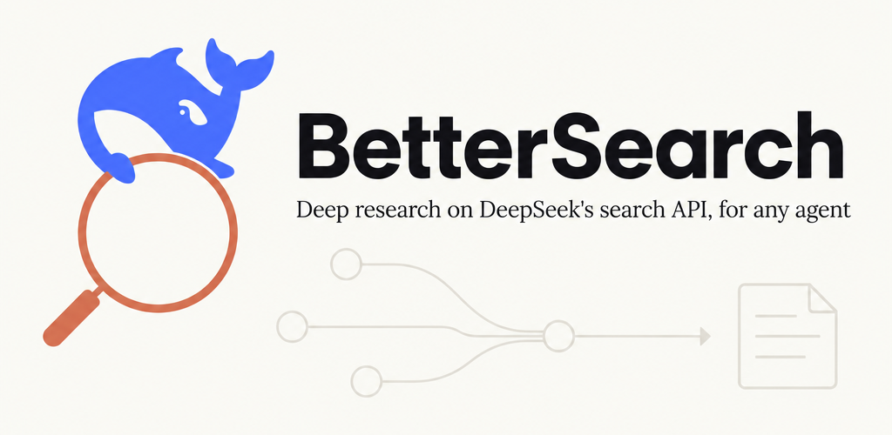

<p align="center">
  
</p>

# BetterSearch

DeepSeek just opened up the search engine behind its app. Any agent can call it now for **$0.75 per 1,000 searches**.

Raw results are decent. But an agent sending one vague query gets one vague answer... and sometimes some of it in Chinese (we searched in English and 2 of the top 5 came back in Chinese).

BetterSearch is a skill that fixes the part around the API: better queries, parallel research, a fact-check pass, and a clean report at the end. It works in Claude Code, Codex, Cursor, Gemini CLI, OpenCode and Hermes.

## Install

```bash
curl -fsSL https://raw.githubusercontent.com/ry0narushima/bettersearch/main/install.sh | bash
```

Then add your DeepSeek key, once:

```bash
python3 ~/.claude/skills/bettersearch/scripts/dsr.py setup
```

It opens the key page, tells you what to click, tests the key and saves it to `~/.config/deepseek-research/` (chmod 600). The key never goes through your agent's chat. `DEEPSEEK_API_KEY` works too.

## Two modes

**Quick** is the default. Ask a normal question, get a sourced answer in chat.

```
you ──► 2-4 sharp queries ──► best 1-3 pages fetched ──► answer + [1] [2] citations
        (lang:, after:, site:)
```

**Advanced** kicks in when you say "deep research", or the question is big.

```
                        ┌──────────────┐
           question ──► │   planner    │  8-20 queries, up to 50 results each
                        └──────┬───────┘
                               ▼
                        ┌──────────────┐
                        │    gather    │  dedupe, rank by authority, fetch top 25
                        └──────┬───────┘
                ┌──────────────┼──────────────┐
                ▼              ▼              ▼
          ┌──────────┐   ┌──────────┐   ┌──────────┐
          │researcher│   │researcher│   │researcher│   one per sub-question,
          └────┬─────┘   └────┬─────┘   └────┬─────┘   in parallel
               └──────────────┼──────────────┘
                              ▼
                       ┌──────────────┐
                       │ fact-checker │  every quote must exist in the source
                       └──────┬───────┘
                              ▼
                       ┌──────────────┐
                       │   reviewer   │  gaps, stale data ──► 1 follow-up round
                       └──────┬───────┘
                              ▼
                        report.html     one offline file: takeaways, charts,
                                        images, confidence per claim, sources
```

No subagent tool in your agent? It runs the same roles one after another. Same output.

## The report

<p align="center">
  
</p>

One self-contained HTML file. No CDN, no JS dependencies, works offline, dark mode included. Every claim is tagged **verified**, **single source** or **conflicting**, and every citation links to its source card.

## What it costs

| | per 1,000 calls |
|---|---|
| DeepSeek Search | $0.75 |
| DeepSeek Fetch | $0.75 |
| Brave Search | $5 |
| Exa Search | from $4 |

A quick question is usually 3 to 6 calls. A deep report is around 40 to 60, so roughly **$0.04**.

Note: search calls made by Claude Code or Codex through DeepSeek's own server-side tools are free until Oct 31, 2026. BetterSearch calls the API directly, so those are billed normally.

## Use the CLI directly

```bash
dsr.py search "deepseek search api lang:en after:2026-10-01" --count 10
dsr.py fetch https://api-docs.deepseek.com/guides/search
dsr.py batch plan.json --out run/
dsr.py report spec.json --out report.html
```

Python 3.9+, standard library only. Throttled under DeepSeek's 5 QPS limit, retries 429s with backoff.

## Files

```
bettersearch/
├── SKILL.md            what your agent reads
├── scripts/dsr.py      search, fetch, batch, report, setup
├── references/         mode guides, role prompts, query tips
├── examples/           sample spec + rendered report
└── install.sh          finds every agent skills folder and installs there
```

## Credits

Built on [DeepSeek's Search & Fetch API](https://api-docs.deepseek.com/guides/search). Not affiliated with DeepSeek. Report fonts: Poppins and Lora (SIL Open Font License). MIT license.
